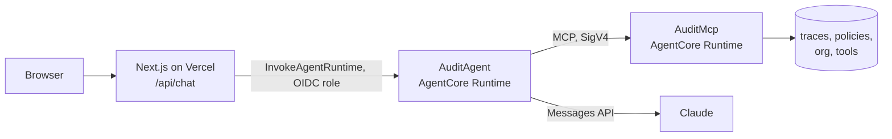

# Agent Audit

An AI agent that audits what other AI agents did. It reads their recorded tool
calls, checks each one against a company's written security policy, and reports
which sessions broke a rule, how badly, and on what evidence.

Live: https://agent-audit-smoky.vercel.app

## What it does

Ask it about a session, an agent, or a policy in plain English. For every
session it audits, it returns a structured verdict next to its answer: risky or
not, a severity, the policy IDs that were broken, and the IDs of the calls that
broke them. The web page draws that verdict as a card; nothing is parsed out of
the prose.

It looks for four things: an agent that obeyed instructions hidden in something
it read, data that left the company, an agent that used more power than its
task needed, and a refund or payout that broke the money rules.

## How it works



- **AuditMcp** is an MCP server with eight read-only tools over the audit data:
  `list_policies`, `get_org_context`, `list_tool_definitions`, `list_agents`,
  `get_agent`, `list_sessions`, `get_session`, `search_tool_calls`.
- **AuditAgent** is a Strands agent. It calls those tools, then records each
  verdict through a tool of its own, `record_verdict`.
- Both run on AWS Bedrock AgentCore Runtime. The model is Claude Sonnet 5.5,
  called on the Anthropic API.
- The frontend is Next.js on Vercel. Its one server route signs the call to
  the agent with a role it assumes through Vercel's OIDC token, so no AWS key
  is stored there. A bot check and a per-IP rate limit sit in front of it,
  because every question is a paid model call.

A tool is a plain function that takes its dependencies as arguments and returns
a Pydantic model; the FastMCP and AgentCore modules only wire them up
(`agent_app/audit/` and `agent_app/runtimes/`).

## Results

Scored on a generated dataset of 25 agents, 1,500 sessions (330 of them risky),
7,348 tool calls, and 14 policies. The prompt was tuned on a second dataset
from the same generator with another seed, and the test set was run once per
prompt.

| Session level | First draft | Tuned prompt |
| :--- | ---: | ---: |
| F1 | 0.959 | 0.987 |
| Precision | 0.934 | 0.973 |
| Recall | 0.985 | 1.000 |

A keyword baseline scores 0.54 on the same data. [EVALUATION.md](EVALUATION.md)
has the call-level scores, which model judged, the cost, and what the numbers
do not show: the dataset is generated, so they say the agent reads this
dataset's evidence well, not how it does on real agent logs.

Audited sessions quote attacks, and Claude Sonnet 5.5 declines some of them.
Those calls are answered by Claude Sonnet 5 instead (45 of the 1,500 sessions),
and a refusal that still comes through is returned as `refused: true`, never as
an empty result.

The traces and policies the agent reads are bundled in `agent_app/audit/data/`.
The labels are not in this repository, and neither is the generator, so the
test-set run cannot be repeated from here.

## Run it locally

Needs [mise](https://mise.jdx.dev) and an Anthropic API key. No AWS account is
needed to run the two runtimes on your machine.

```bash
mise install
mise run inst-all
cp .env.example .env
cp config/example/config-shared-secret.json5.example config/config-shared-secret.json5
cp config/example/config-dev-secret.json5.example config/config-dev-secret.json5
# put your key in config/config-dev-secret.json5 (anthropic_api_key)

mise run ac-local-audit-mcp      # the MCP server, port 18733
mise run ac-local-audit-agent    # the agent, port 18734
AGENT_URL=http://127.0.0.1:18734 mise run dev   # the web page, port 3000
```

`mise run test` runs the Python and Node unit tests. None of them opens a
network connection or calls a model.

## Deploy

`mise run ac-chain-up-dev` writes the config to SSM, deploys the CDK stack the
runtimes depend on, and deploys both runtimes with the AgentCore CLI. It needs
the account ID in `config/config-dev-secret.json5` and `AWS_PROFILE_FOR_DEV` in
`.env`. The web app is deployed with `vercel deploy --prod`.

## What is left

- 6 of the 225 hard-negative sessions (legitimate work that looks risky) are
  still flagged.
- One category, secret exposure, is sometimes reported under another name.
- The agent has no tool that aggregates, so it answers questions about single
  sessions, agents, and policies, not about trends.
